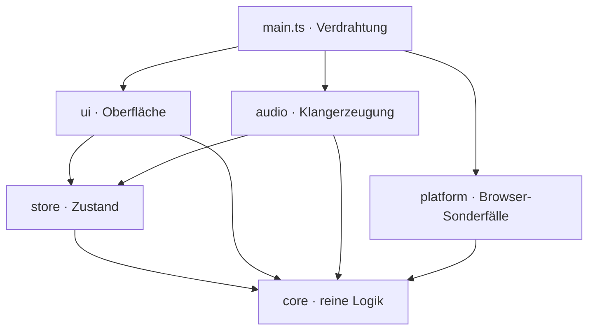
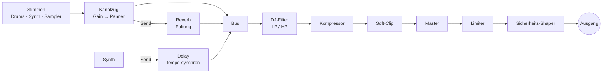

# Pocket 808

**Eine komplette Groovebox in einer einzigen HTML-Datei.** Zehn 808-Drums, zwei Synth-Stimmen nach dem Vorbild des Roland SH-101, ein Sampler mit acht Pads, Mixer, Effekte und Song-Modus. Gebaut für das iPhone und so abgestimmt, dass auch auf einem Telefon nichts knackt.

▶ **Live ausprobieren: [pocket-808.vercel.app](https://pocket-808.vercel.app)**

Aufmachen, auf *Start* tippen, und der Beat läuft. Pocket 808 braucht keine Installation, kein Konto und keinen Server. Alles, was du baust, bleibt in deinem Browser.

> Diese README ist ein **lebendes Dokument**. Sie wird mit jeder Änderung am Projekt aktualisiert. Stand: 2026-10-14, Version 0.15.0.

---

## Was du damit machst

- **Beats bauen wie an der echten Kiste:**
  - 16 Steps und zehn klassische Stimmen: Bass Drum, Snare, Low und High Tom, Rim Shot, Clap, Cowbell, Closed und Open Hat, Becken.
  - Je Stimme Level, Tune und Decay.
  - Die Closed Hat würgt die Open Hat ab, genau wie bei der 808.
- **Rolls und Ghost Notes:** Jeder Step lässt sich in 16 Sub-Steps zerlegen, mit Schnellmustern für Roll, ÷2 und ÷4. Damit werden Trap-Hats und Snare-Wirbel mit einem Tipp möglich.
- **Basslines und Melodien:**
  - Zwei monophone Synth-Stimmen mit Oszillator (Säge, Rechteck, Dreieck, Sinus), Sub-Oszillator, Filter mit Resonanz und zwei ADSR-Hüllkurven.
  - Tonart und Skala wählst du aus, die Piano-Roll bleibt automatisch in der Tonart, falsche Töne gibt es nicht.
  - Ein tempo-synchrones Delay ist eingebaut.
- **Eigene Sounds:**
  - Acht Sampler-Pads, mit Fabrik-Sounds vorbelegt.
  - Eigene Samples kommen per Datei oder Mikrofon. Start- und Endmarke setzt du direkt in der Wellenform, Tune und Hüllkurve gibt es je Pad, auch rückwärts.
  - Jede Drum-Spur lässt sich durch ein eigenes Sample ersetzen.
- **Mischen wie im Club:**
  - Mixer mit 13 Kanälen: Pegel, Panorama, Reverb-Send, Mute und Solo.
  - DJ-Filter (Tiefpass nach links, Hochpass nach rechts) und Reverb mit einstellbarer Raumgröße.
  - **Stutter** zum Halten: Der Klang wiederholt sich in Vierteln, Achteln, Sechzehnteln oder Zweiunddreißigsteln, solange du drückst.
- **Vom Loop zum Song:** Acht Pattern-Plätze (A–H) lassen sich zu einer Song-Kette mit Wiederholungen verbinden. Dazu kommen vier Vorlagen (House, Electro, Hip-Hop, Trap), Kopieren, Einfügen und Zurück.
- **Merkt sich alles:** Jede Änderung wird automatisch gespeichert, auch deine Samples.

---

## Warum es sich gut anfühlt

- **Sofort da:**
  - Audio-Kontext und Klangerzeugung entstehen schon beim Laden, noch stumm.
  - Der Start-Tipp weckt den Kontext nur noch auf, darum gibt es keine Verzögerung.
- **Kein Knacksen auf dem Telefon:**
  - Die zehn Drum-Stimmen werden einmal offline vorgerechnet und beim Spielen nur noch als Puffer abgespielt. Pro Schlag sind das zwei Audio-Knoten statt eines ganzen Synthesizer-Graphen.
  - Ändert sich Tune oder Decay, rechnet die Stimme im Hintergrund kurz neu. Bis der neue Klang fertig ist, spielt der alte weiter.
- **Klingt wie Hardware:**
  - Eine Master-Kette mit Kompressor, sanfter Sättigung und Limiter hält den Mix zusammen.
  - Die Spitze ist auf ≈ 0,77 abgestimmt: laut, aber nie übersteuert.
- **iPhone-Eigenheiten sind gelöst:**
  - Der Stumm-Schalter schaltet die Musik nicht ab.
  - Nach einem Anruf läuft der Ton beim nächsten Tippen weiter.
  - Der Bildschirm bleibt an, solange die Musik spielt.

---

## Technik im Detail

### Eine Datei, null Abhängigkeiten

Der Build erzeugt eine **einzige `index.html`**, in die CSS und JavaScript eingebettet sind. Zur Laufzeit gibt es keine einzige Bibliothek. Die einzige externe Ressource sind zwei Google Fonts (Barlow Condensed und Share Tech Mono). Fehlen sie, springen Systemschriften ein.

So lässt sich die App überall ausliefern: auf Vercel, als Claude-Artifact oder als Datei per Mail.

### Architektur

Der Quelltext ist TypeScript in klar getrennten Schichten. Welche Schicht welche importieren darf, erzwingt ESLint:



| Schicht | Aufgabe | Regeln |
|---|---|---|
| `core` | Datenmodell, Pattern-Operationen, Song-Ablauf, Musiktheorie, Timing, Speicherformat und Migrationen | reine Funktionen ohne DOM, Audio und Pakete; der Zustand ist unveränderlich |
| `store` | Zustand als **ein** Signal, Befehle, Undo, Zwischenablage, entprelltes Speichern | eigener Signals-Kern ohne Framework |
| `audio` | Engine: Master-Kette, Kanalzüge, Drums, Synth, Sampler, Effekte, Scheduler | kennt die UI nicht |
| `ui` | Oberfläche mit drei Layouts | kennt die Audio-Engine nur über eine schmale Schnittstelle |
| `platform` | iOS-Entsperren, Wake Lock, Lebenszyklus, Artifact-Schnittstelle, Dateien | testbar mit Schein-Objekten |

### Zustand: Signals statt Framework

- `src/store/signals.ts` ist ein kleiner, vollständig getesteter Signals-Kern: `signal`, `computed`, `effect`, `batch`.
  - Er arbeitet versionsbasiert und lazy.
  - Er ist glitch-frei: Kein Effekt sieht je einen halb aktualisierten Zustand.
  - Er hat einen Schleifenschutz.
- Der ganze App-Zustand ist **ein** unveränderliches Objekt in einem Wurzel-Signal.
- Weil `core` unveränderte Teile wiederverwendet (strukturelles Teilen), meldet `store.select()` nur echte Änderungen. Ein Klick auf einen Step aktualisiert genau eine Zelle im DOM, nicht die ganze Oberfläche. Ein Test sichert das ab.
- Der Zustand ist immer tief eingefroren (`Object.freeze`). Versehentliches Ändern fällt sofort auf.

### Speichern

- **Ablage:** `localStorage` unter `pocket808.v1` (Zustand) und `pocket808.smp.v1` (Samples als 22,05-kHz-Mono-PCM in Base64).
- **Entprellt:** Gespeichert wird 250 ms nach der letzten Änderung.
- **Fehlertolerant:** Jeder Zugriff läuft in try/catch, ein voller Speicher legt die App nicht lahm.
- **Rückwärtskompatibel:** Beim Laden läuft alles durch `loadState()`. Unbekanntes wird ignoriert, Werte werden begrenzt und alte Formate migriert (zum Beispiel wird der frühere Synth-Regler `sus` in Hüllkurvenwerte umgerechnet). Speicherstände aus jeder bisherigen Version laden weiter.

### Die Audio-Engine



- **Scheduler:**
  - Ein Lookahead-Scheduler im Stil von Chris Wilsons „A Tale of Two Clocks“ läuft alle 25 ms und plant 0,2 s voraus.
  - Jeder Klang wird auf `AudioContext.currentTime` gesetzt, damit bleibt das Timing sample-genau, auch wenn der Haupt-Thread kurz hängt.
  - Swing verschiebt jeden zweiten Step, Sub-Steps teilen den Step in 16 Teile.
- **Drums:**
  - Jede der zehn Stimmen ist ein kleiner Synthesizer aus Oszillatoren, Rauschen, Filtern und Hüllkurven, nach dem Vorbild der analogen Originalschaltungen.
  - Sie werden **nacheinander** in einem `OfflineAudioContext` gerendert, nie parallel, damit das iPhone nicht ins Stocken gerät.
  - Pro Spur klingt immer nur ein Schlag, ein neuer blendet den alten in 6 ms aus. So gibt es keine Klick-Artefakte und keine Stimmen-Lawinen.
- **Rauschen:** Snare, Clap und Rim Shot starten ihr Rauschen sample-genau. Bei der alten Version klangen sie je nach Seitenaufruf zufällig etwas heller oder dumpfer, weil der Rauschpuffer bei einem Bruchteil-Versatz startete. Das ist behoben.
- **Synth:** Die Signalführung folgt dem SH-101: Oszillator mit Sub-Oszillator, Filter mit eigener ADSR, Verstärker mit ADSR. Jede Stimme ist monophon, eine neue Note schneidet die alte sauber ab.
- **Reverb:** Die Impulsantwort wird aus Rauschen mit exponentiellem Abfall berechnet, die Höhen werden über die Zeit gedämpft. Ändert sich die Raumgröße, wird der Hall entprellt neu berechnet und knackfrei getauscht.
- **Live-Parameter:** Mixer, Effekte, Tempo und Synth-Werte wirken während der Wiedergabe. Die Engine hört per Effekt auf genau die Teile des Zustands, die sie braucht, und setzt nur, was sich geändert hat.
- **Testbar:** Kontext, Offline-Kontext, Zeitquelle, Zeitgeber und Zufall lassen sich austauschen. In Tests läuft die Engine deterministisch und ohne echte Uhr.

### Oberfläche (im Neubau)

Die Oberfläche bekommt gerade **drei eigene Layouts**:

| Gerät | Layout |
|---|---|
| **Mobile** | eine Spalte, Geräte als Akkordeon, Startleiste unten |
| **Tablet** | hochkant: Sequencer über die volle Breite, Geräte als Tabs; quer: zwei Spalten, Kopfleiste mit Transport |
| **Desktop** | Studio-Pult ohne Scrollen: Sequencer, Synth, Sampler, Mixer und FX gleichzeitig sichtbar, dazu Tastaturkürzel (Leertaste, 1–8, Pfeile, Cmd/Strg+Z/C/V) |

- **Technik:**
  - Ein einziger Komponentenbaum, die Anordnung macht reines CSS (Cascade Layers, `grid-template-areas`, Container Queries).
  - Beim Drehen des Tablets wird nichts neu aufgebaut.
- **Design:**
  - Flach, ohne Konturen und Schatten; aktive Elemente leuchten in einem gedämpften Kupferton („wie im Club“).
  - Touch zuerst, mit großen Zielen.
  - Alle Regler sind auch per Tastatur bedienbar und für Screenreader beschriftet.

Details: [`docs/superpowers/specs/2026-10-14-ui-layouts-design.md`](docs/superpowers/specs/2026-10-14-ui-layouts-design.md).

---

## Qualität: Wie wir wissen, dass es funktioniert

Pocket 808 wird mit mehr Testcode als App-Code gebaut. Jeder Commit läuft durch einen Git-Hook mit Lint, Typprüfung, Unit- und Referenztests.

| Ebene | Was geprüft wird | Umfang |
|---|---|---|
| **Unit** | `core`, `store` und `audio` einzeln, mit Eigenschafts- und Modelltests (fast-check); Abdeckung ≥ 90 % pro Datei erzwungen | 210 Tests |
| **Referenz** | Die neue Engine klingt wie die bewährte alte App: Beide rendern dieselben Szenarien offline (`node-web-audio-api`) und werden über **Klang-Fingerabdrücke** (Spitze, RMS-Verlauf in 10 ms, spektraler Schwerpunkt) verglichen, dazu Speicherstände und Scheduler-Sequenzen | 161 Tests, 15 Mix-Szenarien, 50 Drum-Varianten |
| **Bench** | Performance-Budget: Audio-Knoten pro Sekunde und Renderzeit für ein Demo- und ein Worst-Case-Pattern | Demo 47 Knoten/s, Worst-Case 429 Knoten/s |
| **E2E** | Playwright auf iPhone- und iPad-Viewport (WebKit) und Desktop (Chromium): Funktion, kein horizontaler Scroll, Screenshots, Barrierefreiheit mit axe, Größenbudget | 20 Tests |

- **Toleranzen kalibriert:** Die Toleranzen der Klang-Fingerabdrücke sind kalibriert. Ein Halbton Verstimmung oder 10 % mehr Decay werden erkannt, Rauschschwankungen nicht.
- **Mutationsprüfung:** Wir bauen absichtlich Fehler ein, zum Beispiel einen ausgebauten Live-Effekt, falschen Swing oder eine Closed Hat, die die Open Hat nicht mehr abwürgt. Der passende Test muss rot werden, sonst fehlt ein Test.

---

## Projektstand

Pocket 808 wird gerade auf ein neues technisches Fundament gestellt. Live läuft bis zur Umstellung die bewährte Version aus `legacy/index.html`.

| Schritt | Inhalt | Stand |
|---|---|---|
| 0 | Gerüst: Vite, TypeScript, ESLint, Prettier, Vitest, Playwright, Git-Hook | ✅ |
| 1 | Referenztests gegen die alte App | ✅ |
| 2 | `core`: Datenmodell, Pattern, Song, Musiktheorie, Speicherformat | ✅ |
| 3 | `store`: Signals-Kern, Zustand, Undo, Speichern | ✅ |
| 4 | `audio`: Engine, gleich zur Referenz | ✅ |
| 5a | UI-Grundgerüst: drei Layouts, Deck, Step-Editor, Spuren, Transport, platform | 🔧 in Arbeit |
| 5b–5d | Synth, Sampler, Mixer/FX/Song in der neuen UI | geplant |
| 6 | Umstellung: die neue App geht live | geplant |

---

## Entwickeln

Voraussetzung ist Node 24 (siehe `.nvmrc`).

```sh
nvm use
npm install
npm run dev           # Vite-Dev-Server mit Hot Reload
npm run build         # dist/index.html, eine eigenständige Datei
npm run preview       # gebaute Datei lokal ausliefern
```

Audio startet erst nach einer Nutzergeste. Das ist eine Browser-Vorgabe, darum der Tipp auf *Start*.

```sh
npm test              # alles: Unit, Referenz, Bench, E2E, alte Tests
npm run test:unit     # schnell: Unit-Tests mit Abdeckung
npm run test:ref      # Klang- und Speicherstand-Referenzen
npm run bench         # Performance-Budget
npm run test:e2e      # Playwright: Mobile, Tablet, Desktop
npm run lint && npm run typecheck
```

Referenzen neu erzeugen geht nur bewusst (`npm run ref:update`, `npm run bench:update`), danach den Diff prüfen.

### Projektstruktur

```
src/core/        reine Logik und Datenmodell
src/store/       Signals-Kern, Store, Speichern
src/audio/       Audio-Engine
legacy/          die bisherige App (live bis zur Umstellung) und ihre alten Tests
tests/reference/ Referenztests gegen legacy/ (Klang, Speicherstände, Bench)
tests/e2e/       Playwright
docs/superpowers/specs/  Spezifikationen
docs/superpowers/plans/  Implementierungspläne
```

---

## Roadmap

Nach dem Fundament, in dieser Reihenfolge:

1. ~~Mixer und FX~~
2. Projekt speichern und laden (`.pocket808.json`), Audio-Export (WAV/MP3)
3. Velocity und Accent, Wahrscheinlichkeit und Bedingungen pro Step
4. Synth: Akkorde, Arpeggiator, Slide und Accent, LFO
5. Sampler: Chop-Modus, melodische Tastatur, Pitch pro Step
6. Live-Aufnahme, Pattern-Länge 8–32, Tap-Tempo und Count-in, mehrstufiges Undo

Außerdem geplant ist ein umschaltbarer **„Warm“-Modus** für einen analogeren Klang: 24-dB-Filter, sanfte Sättigung, leichtes Driften und 808-Hats mit Bandpässen. Er lässt sich direkt im A/B-Vergleich hören.
