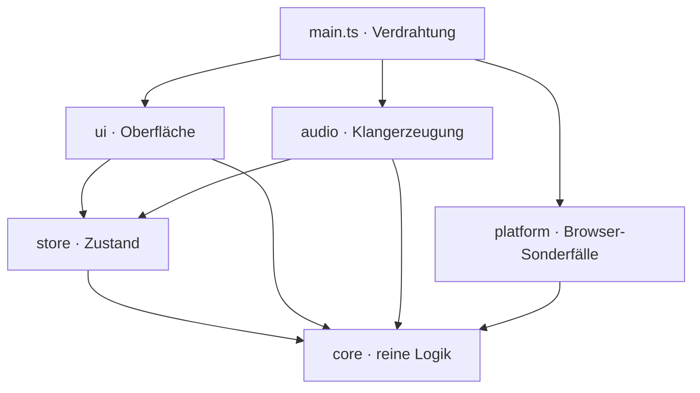
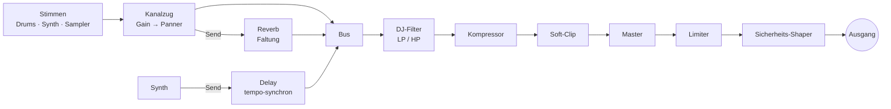

# Pocket 808

**Eine komplette Groovebox in einer einzigen HTML-Datei.** Zehn 808-Drums, zwei Synth-Stimmen nach dem Vorbild des Roland SH-101, ein Sampler mit acht Pads, Mixer, Effekte und Song-Modus. Gebaut für das iPhone und so abgestimmt, dass auch auf einem Telefon nichts knackt.

▶ **Live ausprobieren: [pocket-808.vercel.app](https://pocket-808.vercel.app)**

Aufmachen, auf *Start* tippen, und der Beat läuft. Pocket 808 braucht keine Installation, kein Konto und keinen Server. Alles, was du baust, bleibt in deinem Browser.

> Diese README ist ein **lebendes Dokument**. Sie wird mit jeder Änderung am Projekt aktualisiert. Stand: 2026-11-25, Version 0.29.0. Die neue Oberfläche „Ein Gerät“ liegt auf dem Branch `oberflaeche-ein-geraet` und ist **noch nicht veröffentlicht**: Live ist weiterhin Version 0.28.0 mit der früheren Oberfläche.

---

## Was du damit machst

- **Beats bauen wie an der echten Kiste:**
  - 16 Steps und zehn klassische Stimmen: Bass Drum, Snare, Low und High Tom, Rim Shot, Clap, Cowbell, Closed und Open Hat, Becken.
  - Je Stimme Level, Tune und Decay.
  - Die Closed Hat würgt die Open Hat ab, genau wie bei der 808.
- **Rolls und Ghost Notes:** Jeder Step lässt sich in 16 Sub-Steps zerlegen, mit Schnellmustern für Roll, ÷2 und ÷4. Damit werden Trap-Hats und Snare-Wirbel mit einem Tipp möglich.
- **Lebendige Beats:** Im **Opt**-Modus bekommt jeder Step eigene Optionen, für Drums und Sampler-Pads:
  - **Velocity**, mit Schnellwahl Leise, Mittel, Voll. Ghost Notes und Akzente klingen natürlich, weil der Pegel quadratisch folgt.
  - **Chance:** Der Schlag kommt nur mit dieser Wahrscheinlichkeit.
  - **Bedingung:** 1:2 bis 4:4, Erster, Nicht erster. Damit variiert ein Pattern über 2, 3 oder 4 Durchläufe, ohne dass du ein zweites bauen musst.
  - **Fill:** Die Bedingungen „Fill“ und „Nicht Fill“ reagieren auf die **Fill**-Taste in der Transportleiste (am Rechner: F halten). So spielt ein Pattern seine Fill-Variante, solange du drückst, wie bei OP-XY und Elektron.
  - **Parameter-Locks:** Jeder Step kann eigenes **Tune** und **Decay** haben, Sampler-Steps zusätzlich einen eigenen **Start** im Sample (Chops wie beim EP-133). Gelockte Drum-Steps spielen eigene, offline vorgerenderte Klang-Varianten, also auch hier keine zusätzlichen Audio-Knoten pro Schlag.
  - Leise Steps leuchten schwächer, Steps mit Chance, Bedingung oder Lock tragen einen kleinen Punkt.
- **Basslines und Melodien:**
  - Zwei monophone Synth-Stimmen mit Oszillator (Säge, Rechteck, Dreieck, Sinus), Sub-Oszillator, Filter mit Resonanz und zwei ADSR-Hüllkurven.
  - Pro Note **Akzent** (lauter und heller), **Slide** (gleitet wie bei der TB-303 von der vorigen Note herüber) und **Akkorde** (Dreiklang, Vierklang, Quinte, Oktave, immer passend zur gewählten Tonart). Gesetzt wird mit dem Werkzeug über der Piano-Roll.
  - **Arpeggiator** wie beim SH-101: Auf, Ab, Auf-Ab oder Zufall, in Sechzehnteln oder Zweiunddreißigsteln über eine oder zwei Oktaven. Mit einem Akkord entsteht daraus sofort eine Figur.
  - **LFO** je Stimme für Wobble (Cutoff) oder Vibrato (Pitch), von 0,1 bis 19 Hz.
  - **Drive und Chorus** je Stimme: Drive macht Bässe dicht und fett, Chorus zieht Flächen und Leads stereo auf, während die tiefen Frequenzen in der Mitte bleiben. Alle Synth-Presets nutzen beides.
  - Tonart und Skala wählst du aus, die Piano-Roll bleibt automatisch in der Tonart, falsche Töne gibt es nicht.
  - Ein tempo-synchrones Delay ist eingebaut.
- **Eigene Sounds:**
  - Acht Sampler-Pads, mit Fabrik-Sounds vorbelegt.
  - **Chop:** Ein Pad lässt sich in 2, 4 oder 8 gleich große Slices teilen. *Verteilen* legt die Slices der Reihe nach auf die gesetzten Steps, im Opt-Feld wählst du je Step ein anderes Slice. Die Wellenform zeigt die Schnitte.
  - **Pitch pro Step** in Halbtönen (−12 bis +12) und eine **melodische Tastatur** mit zwölf Tasten und Oktav-Umschaltung, die das gewählte Pad spielt.
  - Eigene Samples kommen per Datei oder Mikrofon. Start- und Endmarke setzt du direkt in der Wellenform, Tune und Hüllkurve gibt es je Pad, auch rückwärts.
  - Jede Drum-Spur lässt sich durch ein eigenes Sample ersetzen.
- **Mischen wie im Club:**
  - Mixer mit 13 Kanälen: Pegel, Panorama, Reverb-Send, Mute und Solo.
  - DJ-Filter (Tiefpass nach links, Hochpass nach rechts) und Reverb mit einstellbarer Raumgröße.
  - **Stutter** zum Halten: Der Klang wiederholt sich in Vierteln, Achteln, Sechzehnteln oder Zweiunddreißigsteln, solange du drückst.
- **Punch-in wie bei den Pocket Operators:** Der Modus **Punch** hat acht Effekte, die wirken, solange du die Taste hältst, auch mehrere zugleich:
  - Loop 1/8 und 1/16
  - Half-Time
  - Tape-Stopp (Tonhöhe und Pegel fallen in einer Sekunde ab wie ein angehaltenes Band)
  - Crush
  - Tiefpass- und Hochpass-Fahrt
  - Echo, das nach dem Loslassen ausklingt
- **Bounce wie beim EP-133:** Ein Tipp rendert das aktuelle Pattern auf das gewählte Sampler-Pad. Dort spielst du es weiter, rückwärts, gestimmt oder in Stücken.
- **Spielspaß wie bei Teenage Engineering:**
  - Das LCD zeigt beim Spielen ein **Oszilloskop** des Master-Ausgangs und die 16 Steps mit Lauflicht, wie beim OP-1. Gezeichnet wird nur während der Wiedergabe; bei „weniger Bewegung“ bleibt die Linie ruhig.
  - **Würfeln** erzeugt eine Variation des Patterns: Ghost-Hats, eine Extra-Kick, ein Snare-Ghost, eine Open Hat am Ende oder eine Hat weniger. Gefällt sie nicht, holt *Zurück* das Original.
  - **Szenen** wie beim OP-XY: acht Speicher für Pegel, Mute und Solo aller Kanäle. Ein Tipp sichert, der nächste ruft ab, live während des Spielens.
- **21 Vorlagen als komplette Starter:** Sie liegen mit Synth-Sounds, Drum-Mustern und Kits in der **Plattenkiste** (Modus *Sound*). Fünf Stile mit je vier bis fünf Vorlagen, Lo-Fi als Schwerpunkt:
  - **Lo-Fi:** Dusty Tape, Rainy Day, Late Night Study, Jazzy Hop, Sleepy Halftime
  - **Hip-Hop:** Classic Boom Bap, Golden Era, G-Funk, Dirty South
  - **Trap:** Atlanta Trap, Dark Trap, UK Drill, Melodic Trap
  - **House:** Classic House, Deep House, Chicago Jack, Tech House
  - **Techno:** Peak Techno, Acid Techno, Minimal, Detroit
  - Eine Vorlage lädt in einem Tipp Tempo, Swing, Tonart, drei Patterns (Groove, Variation, Break) mit Ghost Notes, Rolls, Zufall und Bedingungen, Bass- und Lead-Noten mit Akzent, Slide und Akkorden, dazu Kit, Sounds, Mixer, FX, Klangcharakter und eine Song-Kette.
  - Mit *Laden* wählst du, was ersetzt wird: **Alles**, nur die **Drums** oder nur der **Sound** (bei *Alles* und *Sound* beginnen Mixer und FX vom Standard, dazu kommen die Werte der Vorlage). *Zurück* nimmt das Laden wieder zurück. Die Pattern-Plätze D–H und der Sampler bleiben unberührt.
  - Unter **Basis-Muster** liegen weiter die vier einfachen Drum-Muster (House, Electro, Hip-Hop, Trap).
- **Sechs Drum-Kits** (Classic, Boom, Tight, Lo-Fi, Hard, Trap) stellen Level, Tune und Decay aller Stimmen auf einmal, und je Stimme gibt es jetzt **acht bis neun Synth-Sounds** statt drei (zum Beispiel 808, Reese und Mellow im Bass, Keys, Pad, Stab und Bell im Lead).
- **Warm und Tape:** Im Mixer auf der Seite **FX** schaltet **Warm** den analogen Klang ein: 24-dB-Filter und Sättigung im Synth, leichtes Driften je Note, Hats und Becken über zwei Bandpässe wie in der 808, kein Drum-Treffer gleicht exakt dem anderen. **Tape** dreht eine Bandmaschine dazu: Sättigung, leichtes Eiern der Tonhöhe, weiche Höhen und leises Rauschen mit Knacksern, das nur beim Spielen läuft. Ohne beides klingt alles wie bisher, und der A/B-Vergleich ist ein Tipp.
- **Vom Loop zum Song:** Acht Pattern-Plätze (A–H) lassen sich zu einer Song-Kette mit Wiederholungen verbinden. Dazu kommen Kopieren, Einfügen und Zurück.
- **Live-Aufnahme:** *Rec* schaltet die Aufnahme scharf. Beim Start zählt ein Takt aus vier Klicks vor, dann spielst du ein: mit den Spurtasten, den Pads im Pad-Feld oder den Zeilen-Beschriftungen in „Alle Spuren“ (Bass und Lead nehmen so den Grundton auf), mit den Pads und der Tastatur im Sampler (mit Tonhöhe) oder mit den Tonnamen der Piano-Roll für Noten. Jeder Schlag rastet auf den nächsten Step. Aufgenommen wird nur hinzugefügt, nie gelöscht, im Song-Modus ins gerade laufende Pattern. Ein ganzer Take ist ein einziger Zurück-Schritt.
- **Mehrstufiges Zurück** (bis zu 20 Schritte) und **Tap-Tempo**: Der Knopf *Tap* in der Tempo-Fläche (Tipp auf die BPM im Display; am Rechner die Taste T) liest das Tempo aus deinen Tipps ab, aus dem Mittel der letzten sechs Abstände, im Bereich 60–200 BPM.
- **Merkt sich alles:** Jede Änderung wird automatisch gespeichert, auch deine Samples.
- **Mitnehmen und teilen:**
  - Über den Knopf **Datei** sicherst du das ganze Projekt als `.pocket808.json`, mit allen Pattern, dem Song, Mixer, Effekten und deinen eigenen Samples. Auf dem iPhone öffnet sich dafür das Teilen-Menü („In Dateien sichern“, AirDrop), am Rechner ein Download.
  - Ein Projekt öffnest du auf jedem Gerät wieder. Vorher fragt die App, ob sie das aktuelle ersetzen soll, und *Zurück* holt es zurück.
  - **WAV-Export:** das aktuelle Pattern 1×, 2×, 4× oder 8× oder den ganzen Song, in CD-Qualität (44,1 kHz, 16 Bit, Stereo) mit Ausklang für Hall und Delay. Gerendert wird schneller als Echtzeit, die laufende Musik spielt dabei weiter.
  - Am Rechner gehen ⌘/Strg+S und ⌘/Strg+O.
  - Auch als Claude-Artifact: Dort läuft das Sichern über die Download-Freigabe von Claude. Weil diese keine `.wav` annimmt, kommt die WAV dort unverändert in einer ZIP-Datei.

---

## Ein Gerät: so bedienst du es

Die Oberfläche verhält sich wie ein Hardware-Gerät, nach dem Vorbild des Elektron Digitakt: **ein fester Bildschirm, der nie scrollt**. Von oben nach unten:

| Teil | Inhalt |
|---|---|
| **Display** | BPM (ein Tipp öffnet Tempo, Swing, Master und Tap), Pattern, Meldungen, Oszilloskop, *Zurück* und *Datei* |
| **Modusleiste** | *Spur*, *Sound*, *Mixer*, *Song*, *Punch*, dazu die **Pattern-Taste** (Slots A–H, Kopieren, Einfügen, Würfeln, Pattern leeren) |
| **Spurwahl** | zehn Drums, Bass, Lead und Sampler |
| **Arbeitsfläche** | je nach Modus; in *Spur* die Seiten der gewählten Spur |
| **Step-Bereich** | immer die gewählte Spur, am selben Platz |
| **Transport** | Pattern/Song, Fill, Rec, Start/Stopp |

**Seiten im Modus Spur** (der Spurwechsel behält die Seite, wo es sie gibt):

| Spur | Seiten |
|---|---|
| Drums | Trig (Sub-Steps, Step-Optionen, Leeren) · Klang (Level, Tune, Decay, eigenes Sample) · Mix |
| Bass, Lead | Noten · Klang · Filter · Amp · Bewegung (LFO, Arp) · Mix |
| Sampler | Trig · Klang (Wellenform, Laden, Rec, Bounce, Regler) · Chop · Tasten · Mix; darüber die acht Pads |

- **Sound** ist die Plattenkiste: *Synth-Sound* (Stimme Bass oder Lead), *Vorlagen*, *Basis-Muster*, *Kits*.
- **Mixer** hat die Seiten *Kanäle*, *Szenen* und *FX*, **Song** die Kette, **Punch** die acht Haltetasten.
- Halte-Tasten (Fill, Stutter, Punch) bleiben beim Modus-, Seiten- oder Layoutwechsel nie hängen.

### Je Layout

| | **Telefon** | **Tablet** | **Desktop** |
|---|---|---|---|
| Spurwahl | eine Taste „BA · Bass“ öffnet das **Pad-Feld** (alle Spuren und die acht Pads groß), daneben vorige und nächste Spur | 13 Spurtasten | 13 Spurtasten |
| Seiten | eine zur Zeit, mit Reitern | mehrere nebeneinander, sonst Reiter | mehrere nebeneinander; Mixer komplett auf einem Blick |
| Step-Bereich | 16 Steps in zwei Reihen | 16 Steps, umschaltbar auf **Alle Spuren** | **Alle Spuren**, bei Bass und Lead umschaltbar auf **Noten** |
| Plattenkiste | Reiter je Abschnitt | alle Abschnitte nebeneinander | alle Abschnitte nebeneinander |
| Extras | quer: Arbeitsfläche und Steps nebeneinander | | Tastaturkürzel (Leertaste, 1–8, ↑/↓ durch alle Spuren, Cmd/Strg+Z/C/V/S/O, F halten, T), Hilfe unter „?“ |

- **Telefon:** *Mixer* und *Song* nutzen auch den Platz der Spurwahl und der Steps, ebenso die Seiten *Noten* und *Tasten* den der Steps.
- **Tablet:** Mit „Alle Spuren“ ersetzen die Zeilen-Beschriftungen die Spurtasten (sie wählen und spielen an); das Raster scrollt in sich.
- **Sub und Opt:** Solange eines offen ist, treten die Seitenreiter (beim Sampler auch die Pad-Reihe) zurück, damit das Feld Platz hat.
- **Platz:** Ab 390 × 660 Pixeln passt alles ohne Scrollen. In sich scrollen dürfen nur lange Inhalte: Song-Kette, „Alle Spuren“, Plattenkiste, das Opt-Feld des Samplers am kleinsten Telefon (24 Pixel) und am Telefon quer Arbeitsfläche und Steps.
- *Start*/*Stopp* zeigt am Desktop, bis 460 Pixel Breite und am Telefon quer nur das Symbol.

---

## Warum es sich gut anfühlt

- **Sofort da:**
  - Audio-Kontext und Klangerzeugung entstehen schon beim Laden, noch stumm.
  - Der Start-Tipp weckt den Kontext nur noch auf, darum gibt es keine Verzögerung.
- **Kein Knacksen auf dem Telefon:**
  - Die zehn Drum-Stimmen werden einmal offline vorgerechnet und beim Spielen nur noch als Puffer abgespielt. Pro Schlag sind das zwei Audio-Knoten statt eines ganzen Synthesizer-Graphen.
  - Ändert sich Tune oder Decay, rechnet die Stimme im Hintergrund kurz neu. Bis der neue Klang fertig ist, spielt der alte weiter.
- **Klingt wie Hardware:**
  - Eine Master-Kette mit Kompressor, sanfter Sättigung und Limiter hält den Mix zusammen.
  - Die Spitze ist auf ≈ 0,77 abgestimmt: laut, aber nie übersteuert.
- **iPhone-Eigenheiten sind gelöst:**
  - Der Stumm-Schalter schaltet die Musik nicht ab.
  - Nach einem Anruf läuft der Ton beim nächsten Tippen weiter.
  - Der Bildschirm bleibt an, solange die Musik spielt.

---

## Technik im Detail

### Eine Datei, null Abhängigkeiten

Der Build erzeugt eine **einzige `index.html`**, in die CSS und JavaScript eingebettet sind. Zur Laufzeit gibt es keine einzige Bibliothek. Die einzige externe Ressource sind zwei Google Fonts (Barlow Condensed und Share Tech Mono). Fehlen sie, springen Systemschriften ein.

So lässt sich die App überall ausliefern: auf Vercel, als Claude-Artifact oder als Datei per Mail.

### Architektur

Der Quelltext ist TypeScript in klar getrennten Schichten. Welche Schicht welche importieren darf, erzwingt ESLint:



| Schicht | Aufgabe | Regeln |
|---|---|---|
| `core` | Datenmodell, Pattern-Operationen, Song-Ablauf, Musiktheorie, Timing, Speicherformat und Migrationen | reine Funktionen ohne DOM, Audio und Pakete; der Zustand ist unveränderlich |
| `store` | Zustand als **ein** Signal, Befehle, Undo-Stapel (20 Schritte), Zwischenablage, entprelltes Speichern | eigener Signals-Kern ohne Framework |
| `audio` | Engine: Master-Kette, Kanalzüge, Drums, Synth, Sampler, Effekte, Scheduler | kennt die UI nicht |
| `ui` | Oberfläche mit drei Layouts | kennt die Audio-Engine nur über eine schmale Schnittstelle |
| `platform` | iOS-Entsperren, Wake Lock, Lebenszyklus, Artifact-Schnittstelle, Dateien | testbar mit Schein-Objekten |

### Zustand: Signals statt Framework

- `src/store/signals.ts` ist ein kleiner, vollständig getesteter Signals-Kern: `signal`, `computed`, `effect`, `batch`.
  - Er arbeitet versionsbasiert und lazy.
  - Er ist glitch-frei: Kein Effekt sieht je einen halb aktualisierten Zustand.
  - Er hat einen Schleifenschutz.
- Der ganze App-Zustand ist **ein** unveränderliches Objekt in einem Wurzel-Signal.
- Weil `core` unveränderte Teile wiederverwendet (strukturelles Teilen), meldet `store.select()` nur echte Änderungen. Ein Klick auf einen Step aktualisiert genau eine Zelle im DOM, nicht die ganze Oberfläche. Ein Test sichert das ab.
- Der Zustand ist immer tief eingefroren (`Object.freeze`). Versehentliches Ändern fällt sofort auf.

### Speichern

- **Ablage:** `localStorage` unter `pocket808.v1` (Zustand) und `pocket808.smp.v1` (Samples als 22,05-kHz-Mono-PCM in Base64).
- **Entprellt:** Gespeichert wird 250 ms nach der letzten Änderung.
- **Fehlertolerant:** Jeder Zugriff läuft in try/catch, ein voller Speicher legt die App nicht lahm.
- **Rückwärtskompatibel:** Beim Laden läuft alles durch `loadState()`. Unbekanntes wird ignoriert, Werte werden begrenzt und alte Formate migriert (zum Beispiel wird der frühere Synth-Regler `sus` in Hüllkurvenwerte umgerechnet). Speicherstände aus jeder bisherigen Version laden weiter.

### Die Audio-Engine



- **Scheduler:**
  - Ein Lookahead-Scheduler im Stil von Chris Wilsons „A Tale of Two Clocks“ läuft alle 25 ms und plant 0,2 s voraus.
  - Jeder Klang wird auf `AudioContext.currentTime` gesetzt, damit bleibt das Timing sample-genau, auch wenn der Haupt-Thread kurz hängt.
  - Swing verschiebt jeden zweiten Step, Sub-Steps teilen den Step in 16 Teile.
- **Drums:**
  - Jede der zehn Stimmen ist ein kleiner Synthesizer aus Oszillatoren, Rauschen, Filtern und Hüllkurven, nach dem Vorbild der analogen Originalschaltungen.
  - Sie werden **nacheinander** in einem `OfflineAudioContext` gerendert, nie parallel, damit das iPhone nicht ins Stocken gerät.
  - Pro Spur klingt immer nur ein Schlag, ein neuer blendet den alten in 6 ms aus. So gibt es keine Klick-Artefakte und keine Stimmen-Lawinen.
- **Rauschen:** Snare, Clap und Rim Shot starten ihr Rauschen sample-genau. Bei der alten Version klangen sie je nach Seitenaufruf zufällig etwas heller oder dumpfer, weil der Rauschpuffer bei einem Bruchteil-Versatz startete. Das ist behoben.
- **Synth:** Die Signalführung folgt dem SH-101: Oszillator mit Sub-Oszillator, Filter mit eigener ADSR, Verstärker mit ADSR. Jede Stimme ist monophon, eine neue Note schneidet die alte sauber ab.
  - Akkorde sind **paraphon**: Alle Töne teilen sich ein Filter und einen Verstärker, je Ton zwei Oszillatoren, der Sub nur für den Grundton. Der Mischpegel sinkt mit 1/√n, damit ein Akkord nicht lauter wird als ein Einzelton.
  - Ein **Slide** ist gebunden wie bei der TB-303: Die vorige Note hält ihr Gate bis zum Einsatz, die neue Stimme beginnt auf deren Frequenz und gleitet in 60 ms exponentiell zum Ziel. Ohne neuen Attack übernimmt sie in 6 ms den Pegel der Vorgängerin und klingt von dort mit dem Decay weiter. Die alte Stimme blendet gleichzeitig aus, verankert auf ihrem berechneten Hüllkurvenpegel. Ein Slide startet nur, wenn das Gate der Vorgängerin gerade erst endete. Ein **Akzent** hebt den Pegel um den Faktor 1,35 und öffnet die Filter-Hüllkurve weiter.
  - **Akkordtöne** werden über Halbton-Ziele gewählt (Terz, Quinte, Septime) und auf die nächste Stufe der Skala gelegt. So bleibt jeder Akkord leitereigen, und in der Pentatonik ist eine Quinte trotzdem eine Quinte. Akzent und Akkord hört man beim Setzen im Stand sofort.
  - Der **Arpeggiator** plant im Scheduler aus den Tönen einer Note eine Folge einzelner monophoner Noten (`core/arp.ts`). Der Zufallsmodus hat einen eigenen, reproduzierbaren Zufallsstrom.
  - Der **LFO** ist ein einziger Sinus mit Gain je Stimme. Er entsteht erst, wenn Depth über 0 steht, und verschwindet bei 0 wieder. Pro Note kommt kein Knoten dazu: Der LFO wird auf `detune` des Filters bzw. der Oszillatoren gelegt und wieder gelöst, sobald die Note endet.
  - **Drive und Chorus** (`audio/partfx.ts`) sitzen je Stimme zwischen Eingang und Pegel und entstehen erst, wenn ein Regler über 0 steht. Solange sie läuft, gleicht ein Pegel vor dem Panner aus, dass er Stereo anders verteilt als Mono: Lautstärke, Panorama, Delay und Reverb ändern sich beim Einschalten nicht. Drive ist eine feste Sättigungs-Kennlinie mit Pegelausgleich, Chorus sind zwei langsam modulierte Verzögerungen (links, rechts) hinter einem Hochpass bei 250 Hz.
  - Die Attribute stehen nur in der Note, wenn sie gesetzt sind (`a`, `s`, `ch`). Alte Speicherstände bleiben dadurch bytegleich, und ohne Attribute entsteht kein einziger zusätzlicher Audio-Knoten.
- **Reverb:** Die Impulsantwort wird aus Rauschen mit exponentiellem Abfall berechnet, die Höhen werden über die Zeit gedämpft. Ändert sich die Raumgröße, wird der Hall entprellt neu berechnet und knackfrei getauscht.
- **Live-Parameter:** Mixer, Effekte, Tempo und Synth-Werte wirken während der Wiedergabe. Die Engine hört per Effekt auf genau die Teile des Zustands, die sie braucht, und setzt nur, was sich geändert hat.
- **Testbar:** Kontext, Offline-Kontext, Zeitquelle, Zeitgeber und Zufall lassen sich austauschen. In Tests läuft die Engine deterministisch und ohne echte Uhr.
- **WAV-Export:** Genau diese Austauschbarkeit macht den Export einfach. Eine zweite Engine-Instanz bekommt einen `OfflineAudioContext`, eine Kopie des Zustands und eine eigene Uhr, und der Scheduler wird in 25-ms-Schritten von Hand getaktet, bis der letzte Takt geplant ist (`audio/export.ts`). Danach rechnet der Browser alles in einem Rutsch. Ein Referenztest prüft, dass der Export genauso klingt wie die Wiedergabe.

### Projektdatei

- Eine `.pocket808.json` enthält einen Kopf (`format`, `version`, App-Version, Datum), den Zustand im selben Format wie der Browserspeicher und die Samples als 16-Bit-PCM in Base64.
- Beim Öffnen läuft der Zustand durch dieselbe Prüfung wie jeder Speicherstand: Werte werden begrenzt, alte Formate migriert, Unbekanntes ignoriert. Auch Dateien aus späteren Versionen öffnen sich, soweit möglich.
- Kaputte oder fremde Dateien ändern nichts. Ein beschädigtes Sample leert nur sein eigenes Pad.
- Kodieren und Prüfen sind reine Funktionen in `core/project.ts`, mit einem Eigenschaftstest für die Rundreise.

### Oberfläche

Die Oberfläche hat **drei eigene Layouts**. Welches gilt, entscheidet die App selbst:

| Layout | Bedingung |
|---|---|
| Mobile | schmaler als 768 px, oder ein Telefon im Querformat |
| Tablet | ab 768 px mit Touch (auch ein iPad quer) oder schmaler als 1024 px |
| Desktop | ab 1024 px mit Maus oder Trackpad |

Wie sich das bedient, steht oben unter [Ein Gerät](#ein-gerät-so-bedienst-du-es).

- **Technik:**
  - Ein einziger Komponentenbaum, einmal beim Start aufgebaut. Die Anordnung je Layout macht reines CSS (`styles/layout.css`, Cascade Layers, `grid-template-areas`). Beim Drehen wird nichts neu aufgebaut.
  - **Navigation** (`ui/nav.ts`): Modus, Spur, Seite, unterer Bereich und offene Flächen sind Signale der Oberfläche. Sie werden nicht gespeichert, `State` und Speicherformat sind unverändert.
  - **Rahmen** (`ui/shell.ts`): feste Bereiche Display, Modusleiste, Spurwahl, Arbeitsfläche, Step-Bereich und Transport, dazu drei Flächen (Pad-Feld, Pattern, Tempo). Ein- und Ausblenden läuft über eine einzige Funktion (`show()`), die dabei gehaltene Tasten löst.
  - Die Piano-Roll gibt es genau einmal. Je nach Layout steht sie auf der Seite *Noten* oder unten im Step-Bereich und wandert beim Layoutwechsel mit; die Seite mit dem Tastaturfokus bleibt dabei sichtbar.
  - **Plattenkiste** (`ui/panels/library.ts`): ein Abschnitt je Art von Inhalt; neue Szenen lassen sich ergänzen, ohne die Oberfläche umzubauen.
  - Kein Framework: Kleine DOM-Funktionen (`h`, `bind`, `listen`) binden einzelne Knoten an Ausschnitte des Zustands. Ein Step-Tipp ändert genau eine Zelle im DOM, und Tests zählen das nach.
  - Vorlagen sind Daten in `src/core/templates/` in einer Kurzschreibweise (ein Zeichen pro Drum-Step, Noten als `Step:Stufe:Länge`), die `parse.ts` in gewöhnliche Patterns übersetzt. Laden erzeugt einen normalen Zustand, das Speicherformat kennt keine Vorlagen.
  - Die Bedienlogik steckt als reine Funktionen in `core` (zum Beispiel `core/synth.ts`, `core/sampler.ts`, `core/mixer.ts`). Pad-Samples liegen wie die eigenen Drum-Samples in der SampleBank.
  - Die Oberfläche kennt die Audio-Engine nicht direkt, sondern nur eine schmale Schnittstelle. Plattform-Eigenheiten (iOS-Stummschalter, Wake Lock, Hintergrund, Artifact-Host, Dateiauswahl, Teilen bzw. Download) liegen in einer eigenen Schicht.
- **Design:**
  - Flach, ohne Konturen und Schatten; aktive Elemente leuchten in einem gedämpften Kupferton („wie im Club“).
  - Touch zuerst, mit großen Zielen.
  - Alle Regler sind auch per Tastatur bedienbar und für Screenreader beschriftet.

Details: [`2026-11-25-ui-ein-geraet-design.md`](docs/superpowers/specs/2026-11-25-ui-ein-geraet-design.md) (Aufbau), [Funktionsliste](docs/superpowers/specs/2026-10-14-ui-funktionsliste.md) (jede Bedienhandlung mit Ort und Test) und [`2026-10-14-ui-layouts-design.md`](docs/superpowers/specs/2026-10-14-ui-layouts-design.md) (Layout-Regeln der früheren Oberfläche).

---

## Qualität: Wie wir wissen, dass es funktioniert

Pocket 808 wird mit mehr Testcode als App-Code gebaut. Jeder Commit läuft durch einen Git-Hook mit Lint, Typprüfung, Unit- und Referenztests.

| Ebene | Was geprüft wird | Umfang |
|---|---|---|
| **Unit** | `core`, `store`, `audio`, `ui` und `platform` einzeln (Oberfläche in jsdom), mit Eigenschafts- und Modelltests (fast-check); Abdeckung ≥ 90 % pro Datei erzwungen | 959 Tests |
| **Referenz** | Die neue Engine klingt wie die bewährte alte App, die eingefroren als Vergleichsmaßstab in `tests/reference/legacy/oracle.html` liegt (sie wird nicht mehr ausgeliefert): Beide rendern dieselben Szenarien offline (`node-web-audio-api`) und werden über **Klang-Fingerabdrücke** (Spitze, RMS-Verlauf in 10 ms, spektraler Schwerpunkt) verglichen, dazu Speicherstände, Scheduler-Sequenzen und das Umrechnen importierter Samples (bitgleich) | 218 Tests, 15 Mix-Szenarien, 50 Drum-Varianten, WAV-Export, Step-Optionen, Locks und Fill, Punch-Effekte, Akzent, Slide, Akkorde, Arpeggiator, LFO, Chop und Pitch pro Step, Drive und Chorus; dazu jede der 21 Vorlagen offline gerendert und auf Pegel geprüft (keine Übersteuerung, keine Löcher) |
| **Bench** | Performance-Budget: Audio-Knoten pro Sekunde und Renderzeit für ein Demo- und ein Worst-Case-Pattern | Demo 47 Knoten/s, Worst-Case 429 Knoten/s |
| **E2E** | Playwright auf iPhone hoch und quer, iPad hoch und quer (WebKit) und Desktop (Chromium): Funktion, Kürzel, kein Scrollen der Seite und alles im Bild (je Modus und Seite, ab 390 × 660), kein horizontaler Scroll, Screenshots je Gerät, Barrierefreiheit mit axe (keine schweren Verstöße), alte Speicherstände, Artifact-Host, Projekt sichern und öffnen, WAV-Export, Step-Optionen, Fill und Locks, Punch und Bounce, Würfel und Szenen, Akzent und Akkorde, Arp und LFO, Drive und Chorus, Chop und Pitch, Tap-Tempo und Undo-Stapel, Live-Aufnahme, keine Long Tasks beim Spielen, Touch-Ziele ≥ 44 px, Größenbudget | 313 Tests (dazu 32 je Gerät bewusst übersprungen) |

- **Toleranzen kalibriert:** Die Toleranzen der Klang-Fingerabdrücke sind kalibriert. Ein Halbton Verstimmung oder 10 % mehr Decay werden erkannt, Rauschschwankungen nicht.
- **Mutationsprüfung:** Wir bauen absichtlich Fehler ein, zum Beispiel einen ausgebauten Live-Effekt, falschen Swing oder eine Closed Hat, die die Open Hat nicht mehr abwürgt. Der passende Test muss rot werden, sonst fehlt ein Test.

---

## Projektstand

Pocket 808 steht auf einem neuen technischen Fundament: TypeScript, getrennte Schichten, eigene Layouts für Telefon, Tablet und Desktop. Seit Schritt 6 liefert die Haupt-Adresse die neue App aus. Die frühere Vorschau-Adresse `/next/` leitet dorthin weiter. Speicherstände bleiben erhalten.

| Schritt | Inhalt | Stand |
|---|---|---|
| 0 | Gerüst: Vite, TypeScript, ESLint, Prettier, Vitest, Playwright, Git-Hook | ✅ |
| 1 | Referenztests gegen die alte App | ✅ |
| 2 | `core`: Datenmodell, Pattern, Song, Musiktheorie, Speicherformat | ✅ |
| 3 | `store`: Signals-Kern, Zustand, Undo, Speichern | ✅ |
| 4 | `audio`: Engine, gleich zur Referenz | ✅ |
| 5a | UI-Grundgerüst: drei Layouts, Deck, Step-Editor, Spuren, Transport, Tastaturkürzel, platform | ✅ |
| 5b | Synth in der neuen UI: Piano-Roll, SH-101-Module mit Hüllkurvenanzeige, Presets | ✅ |
| 5c | Sampler in der neuen UI: Pads, Wellenform mit Griffen, Laden und Mikrofon-Aufnahme, Rückwärts, Steps | ✅ |
| 5d | Mixer, FX, Song, Vorlagen in der neuen UI; Desktop-Pult mit stehender Kopfleiste | ✅ |
| 6 | Umstellung: die neue App ist live, alte App und alte Tests entfernt | ✅ (auf dem iPhone abgenommen) |
| Ausbau | Roadmap-Etappen 1–7, 8a, 8b, 9 und 10a (siehe unten) | ✅ live (0.28.0) |
| Ein Gerät | Neue Oberfläche: fester Bildschirm, Modi und Seiten, Plattenkiste, drei Layouts (0.29.0) | gebaut und getestet auf dem Branch; noch nicht live, Abnahme auf dem iPhone offen |

---

## Entwickeln

Voraussetzung ist Node 24 (siehe `.nvmrc`).

```sh
nvm use
npm install
npm run dev           # Dev-Server mit Hot Reload
npm run build         # dist/index.html (eine Datei, alles inline)
npm run preview       # gebaute Datei lokal ausliefern
```

Audio startet erst nach einer Nutzergeste. Das ist eine Browser-Vorgabe, darum der Tipp auf *Start*.

```sh
npm test              # alles: Unit, Referenz, Bench, E2E
npm run test:unit     # schnell: Unit-Tests mit Abdeckung
npm run test:ref      # Klang- und Speicherstand-Referenzen
npm run bench         # Performance-Budget
npm run test:e2e      # Playwright: Mobile (hoch/quer), Tablet (hoch/quer), Desktop
npm run lint && npm run typecheck
```

Referenzen neu erzeugen geht nur bewusst (`npm run ref:update`, `npm run bench:update`), danach den Diff prüfen.

### Projektstruktur

```
src/core/        reine Logik und Datenmodell
src/store/       Signals-Kern, Store, Speichern
src/audio/       Audio-Engine
src/ui/          Oberfläche: DOM-Bausteine, Steuerelemente, Panels, Layouts
src/platform/    iOS, Wake Lock, Lebenszyklus, Artifact-Host, Dateien
src/main.ts      Verdrahtung aller Schichten
index.html       Einstieg (Vite baut daraus dist/index.html)
tests/reference/ Referenztests gegen die eingefrorene alte App (legacy/oracle.html): Klang, Speicherstände, Bench
tests/e2e/       Playwright auf fünf Geräte-Ansichten
docs/superpowers/specs/  Spezifikationen
docs/superpowers/plans/  Implementierungspläne
```

---

## Roadmap

Nach dem Fundament, in dieser Reihenfolge:

1. ~~Mixer und FX~~
2. ~~Projekt speichern und laden (`.pocket808.json`), Audio-Export (WAV)~~ – MP3 bei Bedarf später
3. ~~Velocity und Accent, Wahrscheinlichkeit und Bedingungen pro Step~~
4. ~~**Performance**, inspiriert von Teenage Engineering: Fill-Taste und Parameter-Locks pro Step (4a), Punch-in-Effekte zum Halten und Bounce aufs Pad (4b)~~
5. ~~**Spielspaß:** animiertes Display wie beim OP-1, Würfel für Variationen, Mixer- und Mute-Szenen~~
6. ~~**Synth:** Akkorde, Slide und Accent (6a), Arpeggiator und LFO (6b), Drive und Chorus (10a)~~
7. ~~**Sampler:** Chop-Modus, melodische Tastatur, Pitch pro Step~~
8. ~~Live-Aufnahme mit Count-in~~ (8b), Pattern-Länge 8–32 (8c); ~~Tap-Tempo, mehrstufiges Undo~~ (8a)

9. ~~**Klang und Vorlagen:** Warm und Tape, 21 Vorlagen in fünf Stilen, Kits, mehr Synth-Sounds~~

Dazu außer der Reihe: ~~**Oberfläche „Ein Gerät“:** fester Bildschirm statt langer Seite, Modi und Seiten, Plattenkiste~~ (0.29.0, noch nicht live)

Als Nächstes: Abnahme der neuen Oberfläche auf dem iPhone und Veröffentlichung, dann mehr Synth-Klang und Sounds zur Berliner Electro- und Techno-Szene. Außerdem Feinschliff der Vorlagen nach Gehör auf dem iPhone, weitere Stile (zum Beispiel Electro, Synthwave, UK Garage) und Vorhören einer Vorlage vor dem Laden.
