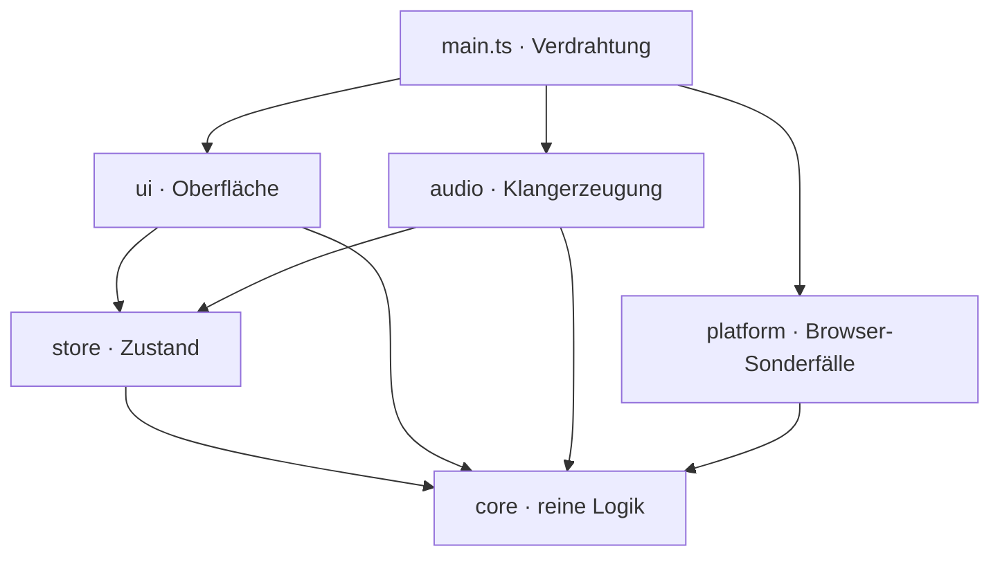
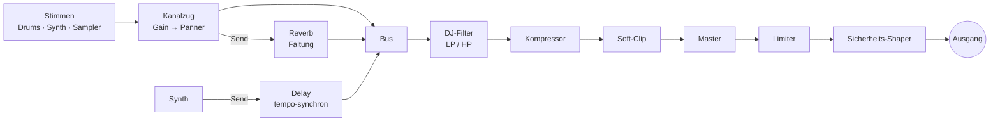

# Pocket 808

**Eine komplette Groovebox in einer einzigen HTML-Datei.** Zehn 808-Drums, zwei Synth-Stimmen nach dem Vorbild des Roland SH-101, ein Sampler mit acht Pads, Mixer, Effekte und Song-Modus. Gebaut für das iPhone und so abgestimmt, dass auch auf einem Telefon nichts knackt.

▶ **Live ausprobieren: [pocket-808.vercel.app](https://pocket-808.vercel.app)**

Aufmachen, auf *Start* tippen, und der Beat läuft. Pocket 808 braucht keine Installation, kein Konto und keinen Server. Alles, was du baust, bleibt in deinem Browser.

> Diese README ist ein **lebendes Dokument**. Sie wird mit jeder Änderung am Projekt aktualisiert. Stand: 2026-10-18, Version 0.21.0.

---

## Was du damit machst

- **Beats bauen wie an der echten Kiste:**
  - 16 Steps und zehn klassische Stimmen: Bass Drum, Snare, Low und High Tom, Rim Shot, Clap, Cowbell, Closed und Open Hat, Becken.
  - Je Stimme Level, Tune und Decay.
  - Die Closed Hat würgt die Open Hat ab, genau wie bei der 808.
- **Rolls und Ghost Notes:** Jeder Step lässt sich in 16 Sub-Steps zerlegen, mit Schnellmustern für Roll, ÷2 und ÷4. Damit werden Trap-Hats und Snare-Wirbel mit einem Tipp möglich.
- **Lebendige Beats:** Im **Opt**-Modus bekommt jeder Step eigene Optionen, für Drums und Sampler-Pads:
  - **Velocity**, mit Schnellwahl Leise, Mittel, Voll. Ghost Notes und Akzente klingen natürlich, weil der Pegel quadratisch folgt.
  - **Chance:** Der Schlag kommt nur mit dieser Wahrscheinlichkeit.
  - **Bedingung:** 1:2 bis 4:4, Erster, Nicht erster. Damit variiert ein Pattern über 2, 3 oder 4 Durchläufe, ohne dass du ein zweites bauen musst.
  - **Fill:** Die Bedingungen „Fill“ und „Nicht Fill“ reagieren auf die **Fill**-Taste in der Transportleiste (am Rechner: F halten). So spielt ein Pattern seine Fill-Variante, solange du drückst, wie bei OP-XY und Elektron.
  - **Parameter-Locks:** Jeder Step kann eigenes **Tune** und **Decay** haben, Sampler-Steps zusätzlich einen eigenen **Start** im Sample (Chops wie beim EP-133). Gelockte Drum-Steps spielen eigene, offline vorgerenderte Klang-Varianten, also auch hier keine zusätzlichen Audio-Knoten pro Schlag.
  - Leise Steps leuchten schwächer, Steps mit Chance, Bedingung oder Lock tragen einen kleinen Punkt.
- **Basslines und Melodien:**
  - Zwei monophone Synth-Stimmen mit Oszillator (Säge, Rechteck, Dreieck, Sinus), Sub-Oszillator, Filter mit Resonanz und zwei ADSR-Hüllkurven.
  - Tonart und Skala wählst du aus, die Piano-Roll bleibt automatisch in der Tonart, falsche Töne gibt es nicht.
  - Ein tempo-synchrones Delay ist eingebaut.
- **Eigene Sounds:**
  - Acht Sampler-Pads, mit Fabrik-Sounds vorbelegt.
  - Eigene Samples kommen per Datei oder Mikrofon. Start- und Endmarke setzt du direkt in der Wellenform, Tune und Hüllkurve gibt es je Pad, auch rückwärts.
  - Jede Drum-Spur lässt sich durch ein eigenes Sample ersetzen.
- **Mischen wie im Club:**
  - Mixer mit 13 Kanälen: Pegel, Panorama, Reverb-Send, Mute und Solo.
  - DJ-Filter (Tiefpass nach links, Hochpass nach rechts) und Reverb mit einstellbarer Raumgröße.
  - **Stutter** zum Halten: Der Klang wiederholt sich in Vierteln, Achteln, Sechzehnteln oder Zweiunddreißigsteln, solange du drückst.
- **Punch-in wie bei den Pocket Operators:** Das Gerät **Punch** hat acht Effekte, die wirken, solange du die Taste hältst, auch mehrere zugleich:
  - Loop 1/8 und 1/16
  - Half-Time
  - Tape-Stopp (Tonhöhe und Pegel fallen in einer Sekunde ab wie ein angehaltenes Band)
  - Crush
  - Tiefpass- und Hochpass-Fahrt
  - Echo, das nach dem Loslassen ausklingt
- **Bounce wie beim EP-133:** Ein Tipp rendert das aktuelle Pattern auf das gewählte Sampler-Pad. Dort spielst du es weiter, rückwärts, gestimmt oder in Stücken.
- **Spielspaß wie bei Teenage Engineering:**
  - Das LCD zeigt beim Spielen ein **Oszilloskop** des Master-Ausgangs und die 16 Steps mit Lauflicht, wie beim OP-1. Gezeichnet wird nur während der Wiedergabe; bei „weniger Bewegung“ bleibt die Linie ruhig.
  - **Würfeln** erzeugt eine Variation des Patterns: Ghost-Hats, eine Extra-Kick, ein Snare-Ghost, eine Open Hat am Ende oder eine Hat weniger. Gefällt sie nicht, holt *Zurück* das Original.
  - **Szenen** wie beim OP-XY: acht Speicher für Pegel, Mute und Solo aller Kanäle. Ein Tipp sichert, der nächste ruft ab, live während des Spielens.
- **Vom Loop zum Song:** Acht Pattern-Plätze (A–H) lassen sich zu einer Song-Kette mit Wiederholungen verbinden. Dazu kommen vier Vorlagen (House, Electro, Hip-Hop, Trap), Kopieren, Einfügen und Zurück.
- **Merkt sich alles:** Jede Änderung wird automatisch gespeichert, auch deine Samples.
- **Mitnehmen und teilen:**
  - Über den Knopf **Datei** sicherst du das ganze Projekt als `.pocket808.json`, mit allen Pattern, dem Song, Mixer, Effekten und deinen eigenen Samples. Auf dem iPhone öffnet sich dafür das Teilen-Menü („In Dateien sichern“, AirDrop), am Rechner ein Download.
  - Ein Projekt öffnest du auf jedem Gerät wieder. Vorher fragt die App, ob sie das aktuelle ersetzen soll, und *Zurück* holt es zurück.
  - **WAV-Export:** das aktuelle Pattern 1×, 2×, 4× oder 8× oder den ganzen Song, in CD-Qualität (44,1 kHz, 16 Bit, Stereo) mit Ausklang für Hall und Delay. Gerendert wird schneller als Echtzeit, die laufende Musik spielt dabei weiter.
  - Am Rechner gehen ⌘/Strg+S und ⌘/Strg+O.
  - Auch als Claude-Artifact: Dort läuft das Sichern über die Download-Freigabe von Claude. Weil diese keine `.wav` annimmt, kommt die WAV dort unverändert in einer ZIP-Datei.

---

## Warum es sich gut anfühlt

- **Sofort da:**
  - Audio-Kontext und Klangerzeugung entstehen schon beim Laden, noch stumm.
  - Der Start-Tipp weckt den Kontext nur noch auf, darum gibt es keine Verzögerung.
- **Kein Knacksen auf dem Telefon:**
  - Die zehn Drum-Stimmen werden einmal offline vorgerechnet und beim Spielen nur noch als Puffer abgespielt. Pro Schlag sind das zwei Audio-Knoten statt eines ganzen Synthesizer-Graphen.
  - Ändert sich Tune oder Decay, rechnet die Stimme im Hintergrund kurz neu. Bis der neue Klang fertig ist, spielt der alte weiter.
- **Klingt wie Hardware:**
  - Eine Master-Kette mit Kompressor, sanfter Sättigung und Limiter hält den Mix zusammen.
  - Die Spitze ist auf ≈ 0,77 abgestimmt: laut, aber nie übersteuert.
- **iPhone-Eigenheiten sind gelöst:**
  - Der Stumm-Schalter schaltet die Musik nicht ab.
  - Nach einem Anruf läuft der Ton beim nächsten Tippen weiter.
  - Der Bildschirm bleibt an, solange die Musik spielt.

---

## Technik im Detail

### Eine Datei, null Abhängigkeiten

Der Build erzeugt eine **einzige `index.html`**, in die CSS und JavaScript eingebettet sind. Zur Laufzeit gibt es keine einzige Bibliothek. Die einzige externe Ressource sind zwei Google Fonts (Barlow Condensed und Share Tech Mono). Fehlen sie, springen Systemschriften ein.

So lässt sich die App überall ausliefern: auf Vercel, als Claude-Artifact oder als Datei per Mail.

### Architektur

Der Quelltext ist TypeScript in klar getrennten Schichten. Welche Schicht welche importieren darf, erzwingt ESLint:



| Schicht | Aufgabe | Regeln |
|---|---|---|
| `core` | Datenmodell, Pattern-Operationen, Song-Ablauf, Musiktheorie, Timing, Speicherformat und Migrationen | reine Funktionen ohne DOM, Audio und Pakete; der Zustand ist unveränderlich |
| `store` | Zustand als **ein** Signal, Befehle, Undo, Zwischenablage, entprelltes Speichern | eigener Signals-Kern ohne Framework |
| `audio` | Engine: Master-Kette, Kanalzüge, Drums, Synth, Sampler, Effekte, Scheduler | kennt die UI nicht |
| `ui` | Oberfläche mit drei Layouts | kennt die Audio-Engine nur über eine schmale Schnittstelle |
| `platform` | iOS-Entsperren, Wake Lock, Lebenszyklus, Artifact-Schnittstelle, Dateien | testbar mit Schein-Objekten |

### Zustand: Signals statt Framework

- `src/store/signals.ts` ist ein kleiner, vollständig getesteter Signals-Kern: `signal`, `computed`, `effect`, `batch`.
  - Er arbeitet versionsbasiert und lazy.
  - Er ist glitch-frei: Kein Effekt sieht je einen halb aktualisierten Zustand.
  - Er hat einen Schleifenschutz.
- Der ganze App-Zustand ist **ein** unveränderliches Objekt in einem Wurzel-Signal.
- Weil `core` unveränderte Teile wiederverwendet (strukturelles Teilen), meldet `store.select()` nur echte Änderungen. Ein Klick auf einen Step aktualisiert genau eine Zelle im DOM, nicht die ganze Oberfläche. Ein Test sichert das ab.
- Der Zustand ist immer tief eingefroren (`Object.freeze`). Versehentliches Ändern fällt sofort auf.

### Speichern

- **Ablage:** `localStorage` unter `pocket808.v1` (Zustand) und `pocket808.smp.v1` (Samples als 22,05-kHz-Mono-PCM in Base64).
- **Entprellt:** Gespeichert wird 250 ms nach der letzten Änderung.
- **Fehlertolerant:** Jeder Zugriff läuft in try/catch, ein voller Speicher legt die App nicht lahm.
- **Rückwärtskompatibel:** Beim Laden läuft alles durch `loadState()`. Unbekanntes wird ignoriert, Werte werden begrenzt und alte Formate migriert (zum Beispiel wird der frühere Synth-Regler `sus` in Hüllkurvenwerte umgerechnet). Speicherstände aus jeder bisherigen Version laden weiter.

### Die Audio-Engine



- **Scheduler:**
  - Ein Lookahead-Scheduler im Stil von Chris Wilsons „A Tale of Two Clocks“ läuft alle 25 ms und plant 0,2 s voraus.
  - Jeder Klang wird auf `AudioContext.currentTime` gesetzt, damit bleibt das Timing sample-genau, auch wenn der Haupt-Thread kurz hängt.
  - Swing verschiebt jeden zweiten Step, Sub-Steps teilen den Step in 16 Teile.
- **Drums:**
  - Jede der zehn Stimmen ist ein kleiner Synthesizer aus Oszillatoren, Rauschen, Filtern und Hüllkurven, nach dem Vorbild der analogen Originalschaltungen.
  - Sie werden **nacheinander** in einem `OfflineAudioContext` gerendert, nie parallel, damit das iPhone nicht ins Stocken gerät.
  - Pro Spur klingt immer nur ein Schlag, ein neuer blendet den alten in 6 ms aus. So gibt es keine Klick-Artefakte und keine Stimmen-Lawinen.
- **Rauschen:** Snare, Clap und Rim Shot starten ihr Rauschen sample-genau. Bei der alten Version klangen sie je nach Seitenaufruf zufällig etwas heller oder dumpfer, weil der Rauschpuffer bei einem Bruchteil-Versatz startete. Das ist behoben.
- **Synth:** Die Signalführung folgt dem SH-101: Oszillator mit Sub-Oszillator, Filter mit eigener ADSR, Verstärker mit ADSR. Jede Stimme ist monophon, eine neue Note schneidet die alte sauber ab.
- **Reverb:** Die Impulsantwort wird aus Rauschen mit exponentiellem Abfall berechnet, die Höhen werden über die Zeit gedämpft. Ändert sich die Raumgröße, wird der Hall entprellt neu berechnet und knackfrei getauscht.
- **Live-Parameter:** Mixer, Effekte, Tempo und Synth-Werte wirken während der Wiedergabe. Die Engine hört per Effekt auf genau die Teile des Zustands, die sie braucht, und setzt nur, was sich geändert hat.
- **Testbar:** Kontext, Offline-Kontext, Zeitquelle, Zeitgeber und Zufall lassen sich austauschen. In Tests läuft die Engine deterministisch und ohne echte Uhr.
- **WAV-Export:** Genau diese Austauschbarkeit macht den Export einfach. Eine zweite Engine-Instanz bekommt einen `OfflineAudioContext`, eine Kopie des Zustands und eine eigene Uhr, und der Scheduler wird in 25-ms-Schritten von Hand getaktet, bis der letzte Takt geplant ist (`audio/export.ts`). Danach rechnet der Browser alles in einem Rutsch. Ein Referenztest prüft, dass der Export genauso klingt wie die Wiedergabe.

### Projektdatei

- Eine `.pocket808.json` enthält einen Kopf (`format`, `version`, App-Version, Datum), den Zustand im selben Format wie der Browserspeicher und die Samples als 16-Bit-PCM in Base64.
- Beim Öffnen läuft der Zustand durch dieselbe Prüfung wie jeder Speicherstand: Werte werden begrenzt, alte Formate migriert, Unbekanntes ignoriert. Auch Dateien aus späteren Versionen öffnen sich, soweit möglich.
- Kaputte oder fremde Dateien ändern nichts. Ein beschädigtes Sample leert nur sein eigenes Pad.
- Kodieren und Prüfen sind reine Funktionen in `core/project.ts`, mit einem Eigenschaftstest für die Rundreise.

### Oberfläche

Die Oberfläche hat **drei eigene Layouts**. Welches gilt, entscheidet die App selbst:

| Layout | Bedingung |
|---|---|
| Mobile | schmaler als 768 px, oder ein Telefon im Querformat |
| Tablet | ab 768 px mit Touch (auch ein iPad quer) oder schmaler als 1024 px |
| Desktop | ab 1024 px mit Maus oder Trackpad |

So sieht es auf den einzelnen Geräten aus:

| Gerät | Layout |
|---|---|
| **Mobile** | eine Spalte, Geräte als Akkordeon, Startleiste unten |
| **Tablet** | hochkant: Sequencer über die volle Breite, Geräte als Tabs; quer: zwei Spalten, Kopfleiste mit Transport |
| **Desktop** | Studio-Pult: links Sequencer, Spuren, Song und Vorlagen, rechts Synth, Sampler, Mixer und FX in zwei fließenden Spalten, alle offen. Die Kopfleiste mit Tempo, Pattern-Slots und Start bleibt beim Scrollen stehen. Dazu Tastaturkürzel (Leertaste, 1–8, Pfeile, Cmd/Strg+Z/C/V) |

- **Technik:**
  - Ein einziger Komponentenbaum, die Anordnung macht reines CSS (Cascade Layers, `grid-template-areas`, Container Queries).
  - Beim Drehen des Tablets wird nichts neu aufgebaut.
  - Kein Framework: Kleine DOM-Funktionen (`h`, `bind`, `listen`) binden einzelne Knoten an Ausschnitte des Zustands. Ein Step-Tipp ändert genau eine Zelle im DOM, das Lauflicht zwei, und Tests zählen das nach.
  - Synth, Sampler, Mixer und FX sitzen in einem Geräte-Halter: auf dem iPhone als Akkordeon, auf dem Tablet als Tabs, auf dem Desktop alle offen.
  - Der Sampler ist ebenfalls umgezogen: acht Pads, Wellenform auf einem Canvas mit ziehbaren Start- und Endmarken, Laden per Datei oder Mikrofon (MediaRecorder, mit Rückfall auf die Aufnahme-App), Rückwärts, Regler und Steps mit Sub-Modus. Pad-Samples liegen wie die eigenen Drum-Samples in der SampleBank.
  - Mixer und FX: 13 Kanalzüge mit Fader, Mute und Solo, Pan (rastet beim Ziehen in der Mitte ein) und Reverb-Send für den gewählten Kanal; Reverb (Return, Size, Damp), DJ-Filter (Tiefpass links, Hochpass rechts, Mitte aus) und Stutter zum Halten, das beim Loslassen, Abbrechen oder Verlieren des Zeigers immer ausgeht.
  - Song und Vorlagen: Song-Kette aus Blöcken mit Wiederholungen, verschieben, entfernen, leeren; die gespielte Position leuchtet. Vorlagen (House, Electro, Hip-Hop, Trap), Kopieren, Einfügen, Pattern leeren und Zurück.
  - Der Synth ist umgezogen: Piano-Roll mit Takthälften und Notenlängen, die fünf SH-101-Module mit Drehreglern, senkrechten ADSR-Schiebereglern und live gezeichneter Hüllkurve, Presets je Stimme. Die Bedienlogik steckt als reine Funktionen in `core/synth.ts`.
  - Die Oberfläche kennt die Audio-Engine nicht direkt, sondern nur eine schmale Schnittstelle. Plattform-Eigenheiten (iOS-Stummschalter, Wake Lock, Hintergrund, Artifact-Host, Dateiauswahl, Teilen bzw. Download) liegen in einer eigenen Schicht.
- **Design:**
  - Flach, ohne Konturen und Schatten; aktive Elemente leuchten in einem gedämpften Kupferton („wie im Club“).
  - Touch zuerst, mit großen Zielen.
  - Alle Regler sind auch per Tastatur bedienbar und für Screenreader beschriftet.

Details: [`docs/superpowers/specs/2026-10-14-ui-layouts-design.md`](docs/superpowers/specs/2026-10-14-ui-layouts-design.md).

---

## Qualität: Wie wir wissen, dass es funktioniert

Pocket 808 wird mit mehr Testcode als App-Code gebaut. Jeder Commit läuft durch einen Git-Hook mit Lint, Typprüfung, Unit- und Referenztests.

| Ebene | Was geprüft wird | Umfang |
|---|---|---|
| **Unit** | `core`, `store`, `audio`, `ui` und `platform` einzeln (Oberfläche in jsdom), mit Eigenschafts- und Modelltests (fast-check); Abdeckung ≥ 90 % pro Datei erzwungen | 593 Tests |
| **Referenz** | Die neue Engine klingt wie die bewährte alte App, die eingefroren als Vergleichsmaßstab in `tests/reference/legacy/oracle.html` liegt (sie wird nicht mehr ausgeliefert): Beide rendern dieselben Szenarien offline (`node-web-audio-api`) und werden über **Klang-Fingerabdrücke** (Spitze, RMS-Verlauf in 10 ms, spektraler Schwerpunkt) verglichen, dazu Speicherstände, Scheduler-Sequenzen und das Umrechnen importierter Samples (bitgleich) | 178 Tests, 15 Mix-Szenarien, 50 Drum-Varianten, WAV-Export, Step-Optionen, Locks und Fill, Punch-Effekte |
| **Bench** | Performance-Budget: Audio-Knoten pro Sekunde und Renderzeit für ein Demo- und ein Worst-Case-Pattern | Demo 47 Knoten/s, Worst-Case 429 Knoten/s |
| **E2E** | Playwright auf iPhone hoch und quer, iPad hoch und quer (WebKit) und Desktop (Chromium): Funktion, Kürzel, kein horizontaler Scroll, Screenshots je Gerät, Barrierefreiheit mit axe (keine schweren Verstöße), alte Speicherstände, Artifact-Host, Projekt sichern und öffnen, WAV-Export, Step-Optionen, Fill und Locks, Punch und Bounce, Würfel und Szenen, keine Long Tasks beim Spielen, Touch-Ziele ≥ 44 px, Größenbudget | 222 Tests |

- **Toleranzen kalibriert:** Die Toleranzen der Klang-Fingerabdrücke sind kalibriert. Ein Halbton Verstimmung oder 10 % mehr Decay werden erkannt, Rauschschwankungen nicht.
- **Mutationsprüfung:** Wir bauen absichtlich Fehler ein, zum Beispiel einen ausgebauten Live-Effekt, falschen Swing oder eine Closed Hat, die die Open Hat nicht mehr abwürgt. Der passende Test muss rot werden, sonst fehlt ein Test.

---

## Projektstand

Pocket 808 steht auf einem neuen technischen Fundament: TypeScript, getrennte Schichten, eigene Layouts für Telefon, Tablet und Desktop. Seit Schritt 6 liefert die Haupt-Adresse die neue App aus. Die frühere Vorschau-Adresse `/next/` leitet dorthin weiter. Speicherstände bleiben erhalten.

| Schritt | Inhalt | Stand |
|---|---|---|
| 0 | Gerüst: Vite, TypeScript, ESLint, Prettier, Vitest, Playwright, Git-Hook | ✅ |
| 1 | Referenztests gegen die alte App | ✅ |
| 2 | `core`: Datenmodell, Pattern, Song, Musiktheorie, Speicherformat | ✅ |
| 3 | `store`: Signals-Kern, Zustand, Undo, Speichern | ✅ |
| 4 | `audio`: Engine, gleich zur Referenz | ✅ |
| 5a | UI-Grundgerüst: drei Layouts, Deck, Step-Editor, Spuren, Transport, Tastaturkürzel, platform | ✅ |
| 5b | Synth in der neuen UI: Piano-Roll, SH-101-Module mit Hüllkurvenanzeige, Presets | ✅ |
| 5c | Sampler in der neuen UI: Pads, Wellenform mit Griffen, Laden und Mikrofon-Aufnahme, Rückwärts, Steps | ✅ |
| 5d | Mixer, FX, Song, Vorlagen in der neuen UI; Desktop-Pult mit stehender Kopfleiste | ✅ |
| 6 | Umstellung: die neue App ist live, alte App und alte Tests entfernt | ✅ (auf dem iPhone abgenommen) |

---

## Entwickeln

Voraussetzung ist Node 24 (siehe `.nvmrc`).

```sh
nvm use
npm install
npm run dev           # Dev-Server mit Hot Reload
npm run build         # dist/index.html (eine Datei, alles inline)
npm run preview       # gebaute Datei lokal ausliefern
```

Audio startet erst nach einer Nutzergeste. Das ist eine Browser-Vorgabe, darum der Tipp auf *Start*.

```sh
npm test              # alles: Unit, Referenz, Bench, E2E
npm run test:unit     # schnell: Unit-Tests mit Abdeckung
npm run test:ref      # Klang- und Speicherstand-Referenzen
npm run bench         # Performance-Budget
npm run test:e2e      # Playwright: Mobile (hoch/quer), Tablet (hoch/quer), Desktop
npm run lint && npm run typecheck
```

Referenzen neu erzeugen geht nur bewusst (`npm run ref:update`, `npm run bench:update`), danach den Diff prüfen.

### Projektstruktur

```
src/core/        reine Logik und Datenmodell
src/store/       Signals-Kern, Store, Speichern
src/audio/       Audio-Engine
src/ui/          Oberfläche: DOM-Bausteine, Steuerelemente, Panels, Layouts
src/platform/    iOS, Wake Lock, Lebenszyklus, Artifact-Host, Dateien
src/main.ts      Verdrahtung aller Schichten
index.html       Einstieg (Vite baut daraus dist/index.html)
tests/reference/ Referenztests gegen die eingefrorene alte App (legacy/oracle.html): Klang, Speicherstände, Bench
tests/e2e/       Playwright auf fünf Geräte-Ansichten
docs/superpowers/specs/  Spezifikationen
docs/superpowers/plans/  Implementierungspläne
```

---

## Roadmap

Nach dem Fundament, in dieser Reihenfolge:

1. ~~Mixer und FX~~
2. ~~Projekt speichern und laden (`.pocket808.json`), Audio-Export (WAV)~~ – MP3 bei Bedarf später
3. ~~Velocity und Accent, Wahrscheinlichkeit und Bedingungen pro Step~~
4. ~~**Performance**, inspiriert von Teenage Engineering: Fill-Taste und Parameter-Locks pro Step (4a), Punch-in-Effekte zum Halten und Bounce aufs Pad (4b)~~
5. ~~**Spielspaß:** animiertes Display wie beim OP-1, Würfel für Variationen, Mixer- und Mute-Szenen~~
6. Synth: Akkorde, Arpeggiator, Slide und Accent, LFO
7. Sampler: Chop-Modus, melodische Tastatur, Pitch pro Step
8. Live-Aufnahme, Pattern-Länge 8–32, Tap-Tempo und Count-in, mehrstufiges Undo

Außerdem geplant ist ein umschaltbarer **„Warm“-Modus** für einen analogeren Klang: 24-dB-Filter, sanfte Sättigung, leichtes Driften und 808-Hats mit Bandpässen. Er lässt sich direkt im A/B-Vergleich hören.
